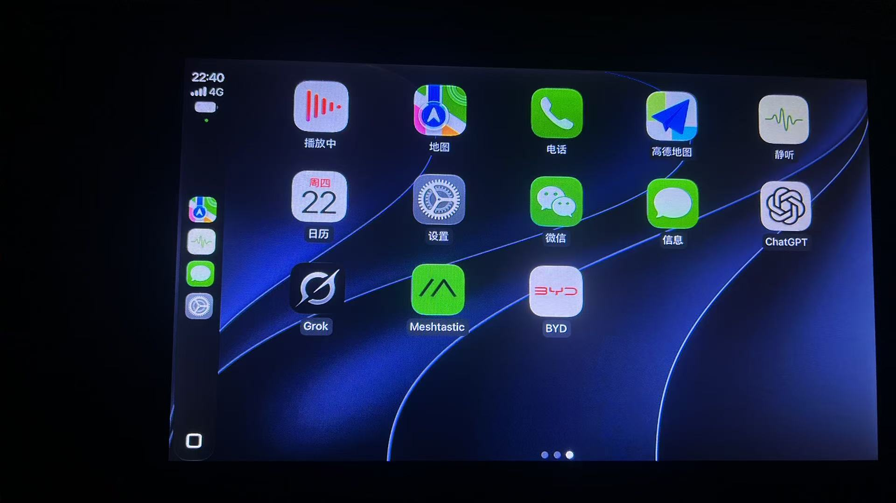

# DiPlay-Legacy-Android4.2

[简体中文](README.md) · [English](README.en.md)

DiPlay-Legacy-Android4.2 是一个运行在 Android 车机上的独立 CarPlay 接收端，不运行在 iPhone 上。
核心功能不需要越狱、外接盒子、Mac、账号或认证服务器，支持有线 USB 与无线 CarPlay，界面沿用
DiAuto 风格。

本项目直接基于 [programmerguohuajing/DiPlay-Legacy-Android](https://github.com/programmerguohuajing/DiPlay-Legacy-Android)
的源码深度修改（爆改）而来；该仓库又基于
[shihabal3amri/DiPlay](https://github.com/shihabal3amri/DiPlay) 与
[xcertplay](https://github.com/shilapi/xcertplay) 开发。

新仓库：[JoeFee2024/DiPlay-Legacy-Android4.2](https://github.com/JoeFee2024/DiPlay-Legacy-Android4.2)

> **当前发布：V1.0**
>
> V1.0 基于 `0.2.64` 源码构建，已在真实 Android 4.2 车机上完成测试，包括
> Android 4.2/4.3 使用的 ExoPlayer 2 车内视频路径。不同车机、固件和 iOS 版本仍可能存在差异，
> 这不代表所有老车机都能获得相同结果。
>
> 当前 APK 是 `standalone debug` 构建：应用内版本显示 `0.2.64-hud-test`，包名为
> `com.shihab.diplay.hudtest`，使用调试证书签名。哈希文件只用于校验下载完整性，不等同于
> 正式发布签名。

## 车机测试截图

以下为车机端界面与测试环境截图：

| DiPlay 连接首页 | 车机桌面 |
| :---: | :---: |
|  |  |

## 下载与哈希校验

| 项目 | 内容 |
| --- | --- |
| 发布文件 | `DiPlay-Legacy-Android4.2-V1.0.apk` |
| SHA-256 | `fa3172e88687b7b588c476058352acb1f3f56385523a4f10b539b3b0aaceb2ee` |
| 哈希文件 | [DiPlay-Legacy-Android4.2-V1.0.apk.sha256](DiPlay-Legacy-Android4.2-V1.0.apk.sha256) |
| 下载地址 | [GitHub Releases](https://github.com/JoeFee2024/DiPlay-Legacy-Android4.2/releases) |

下载后请把 APK 与同名 `.sha256` 文件放在同一目录，再执行：

```sh
# macOS / Linux
shasum -a 256 DiPlay-Legacy-Android4.2-V1.0.apk
sha256sum DiPlay-Legacy-Android4.2-V1.0.apk

# Windows
certutil -hashfile DiPlay-Legacy-Android4.2-V1.0.apk SHA256
```

结果应与 `.sha256` 文件中的值完全一致。**如果不一致，请不要安装。**

哈希文件用于确认下载过程中文件没有被篡改或损坏；APK 的安装签名是另一项独立校验。当前
V1.0 使用调试证书签名，不是正式的 Release 签名包。

## 项目概览

| 项目 | 说明 |
| --- | --- |
| 最低 Android | 4.2 Jelly Bean (API 17) |
| CPU 架构 | `armeabi-v7a`、`arm64-v8a`、`x86`、`x86_64` |
| 老系统 USB | 原始描述符与 `usbfs`，USBMUX/NCM 共用设备描述符 |
| 老系统蓝牙 | AOSP RFCOMM，以及 HSAE/Hybrid 适配器探测 |
| 老系统 Wi-Fi | KitKat 接口发现、Wi-Fi Direct、车机热点、同一局域网 |
| 老系统运行时 | Dalvik、multidex、核心库脱糖、API 分支保护 |
| 安装器兼容 | Release APK 支持 v1 + v2 签名（V1.0 为 debug 包） |
| 车内视频 | API 17/18 使用 ExoPlayer 2.19.1，API 19+ 使用 Media3 |
| 源码版本 | `0.2.64`，versionCode `84` |

## 功能

- **有线 CarPlay：** USB 数据口、USB Host/NCM 传输、本地 VPN 链路与触控转发。
- **无线 CarPlay：** 车机自带热点、Wi-Fi Direct、Existing Wi-Fi / 同一局域网。
- **离线认证：** 内置实验性附件身份，不依赖外部认证服务器。
- **比亚迪集成：** 已验证固件上的 HUD 转向指引、仪表盘地图、车机热点自动化和可选的通话按键。
- **显示与音频：** 分辨率、帧率、图标/文字大小、昼夜外观、画面调整、Dock、系统栏、界面缩放、
  音频路由和音乐缓冲。
- **车辆控制：** 方向盘按键、Siri 键、比亚迪摇杆、地图缩放、车机按键和 CarPlay 手势。
- **诊断与更新：** 本地诊断报告，以及面向老系统的应用内更新。
- **语言：** English、العربية、Español、Русский、Українська、简体中文、繁體中文。
  支持 Android 13+ 的按应用语言设置。

部分功能属于实验性功能，默认关闭。它们会在设置页和版本说明中单独标注；依赖 ADB 或车辆数据的
功能需要兼容固件，并且必须由用户明确开启。

## 在原项目上为 Android 4.2 做了哪些适配

本仓库在 [programmerguohuajing/DiPlay-Legacy-Android](https://github.com/programmerguohuajing/DiPlay-Legacy-Android)
的基础上，把 Android 4.2/4.3 从“能安装、能启动”继续推进到真实车机上的连接、显示和车内视频。
适配不是只把 `minSdk` 改成 17，而是同时处理了构建工具链、Dalvik 类加载、缺失的框架 API、
老式 USB/蓝牙/Wi-Fi 栈、视频解码和旧版安装器。当前代码中的主要工作如下。

### 1. 构建与运行时底座

- 将 `:mobile`、`:common`、`:shared` 三个模块统一到 `minSdk 17`，继续使用 `compileSdk 37`
  和 `targetSdk 37`。
- 启用 `coreLibraryDesugaring` 和 multidex，让 `java.time`、stream、Optional 等 Java 8 API
  能在 Dalvik 上运行；同时保留对 Android 4.2 不存在的 JDK/框架方法的显式降级。
- 使用 `realSdkInt()` 按车机真实运行的框架版本做分支，而不是只信 `Build.VERSION.SDK_INT`。
  部分全志 T3 和改版 ROM 会把版本号报成 27/28，实际仍是 KitKat 框架；直接走新 API 分支会抛
  `NoSuchMethodError`。
- 由 `LegacyApiGuardTest` 扫描三个 `minSdk 17` 主源码集，阻止已知会在 4.2 上崩溃的调用
  重新进入代码。

### 2. Dalvik 类加载与缺失 API

Dalvik 在链接一个类时就会解析 `catch` 类型、父类和接口；只要其中一个类型在 API 17 上不存在，
整个类会直接 `VerifyError`。本仓库对应处理了：

| Android 4.2 上的问题 | 当前处理 |
| --- | --- |
| `catch (ReflectiveOperationException)` 导致 `CarPlayController` 等类加载失败 | 改为捕获 `Exception`，需要时再用类型判断缩小范围 |
| `AutoCloseable` 作为接口/`use` 隐式转换 | 改用 API 1 就存在的 `java.io.Closeable`，锁在 `finally` 中显式释放 |
| `ThreadLocal.withInitial`、`removeIf`、`computeIfAbsent` 的 lambda 依赖 `java.util.function` | 改为匿名 `ThreadLocal`、迭代器循环和 `get`/`putIfAbsent` |
| `Long.toUnsignedString`、`MotionEvent.actionToString`、`Math.floorDiv`、`InetAddress.getLoopbackAddress`、`Throwable.addSuppressed` | 用本地兼容函数替换；`LegacyApiGuardTest` 禁止重新引入 |
| USB 五参数 `bulkTransfer`（API 18） | API 17 使用四参数重载，并用 `copyOfRange` 切片 |
| `NetworkInterface.getIndex()`（API 19） | 低版本读取 `/sys/class/net/<if>/ifindex` |
| `BluetoothManager`、`BluetoothDevice.getType()`、`MediaCodec.getName()`、`AccessibilityNodeInfo.getViewIdResourceName()` | 全部加版本判断或改用 API 17 可用的替代路径 |
| 媒体按键 `PendingIntent` 重载、`AudioTrack.setVolume()`、`FrameLayout.LayoutParams` 拷贝构造、`FileLock.use` | 分别改用 `ComponentName`、`setStereoVolume()`、显式宽高/边距和 `finally` 释放 |

### 3. 老系统的 USB、蓝牙与 Wi-Fi 链路

- USB Host 直接处理原始设备描述符和 `usbfs`，兼容 USBMUX 与 NCM 共用描述符的车机实现。
- 对老式 USB 传输的包长、超时和重试做降级；USB 权限与自动确认服务在 API 17 上走兼容路径。
- 蓝牙使用 AOSP RFCOMM 配对/连接，并保留 HSAE/Hybrid 外置适配器探测。
- Wi-Fi 兼容 KitKat 的接口枚举、Wi-Fi Direct、车机自带热点和同一局域网模式；API 28+ 的
  `WifiP2pGroupManager` 不会在 4.2 上加载，改走旧版反射路径。
- 本地 VPN TUN、AirPlay 加密握手、PCM 音频和触控转发都在 API 17 路径上做了保护。

### 4. Android 4.2/4.3 的车内视频

这是本分支相较父项目最关键的增量。父项目已经覆盖了 4.2 上的安装、设置、AirPlay 加密握手、
手动蓝牙配对、VPN TUN 和 PCM 音频，但车内视频在 4.2 上没有通过。当前实现改为：

- `CarPlayVideo.show()` 在 API 17/18 选择 `CarPlayVideoLegacyActivity`，API 19+ 继续使用
  Media3 的 `CarPlayVideoActivity`；两个播放器实现同一个 `CarPlayVideoPlayer` 接口。
- 4.2/4.3 播放器使用 ExoPlayer 2.19.1 的 `core` + `hls`，不依赖 Media3。因为它声明
  `minSdk 16`，所以可以在 API 17 上加载。
- 老播放器使用普通 `SurfaceView` 和自定义比例布局，刻意不引入 `exoplayer-ui`：ExoPlayer 2
  和 Media3 都会生成 `exo_*` 资源，资源合并后会拿到 Media3 的布局，导致 `PlayerView` 强转失败。
- `LegacyIphoneResolvingDataSource` 是 `IphoneResolvingDataSource` 的 ExoPlayer 2 版本，
  保留相同的 iPhone URL 解析和白名单策略；播放器的控制条、画面比例和状态机与新版一致。
- 针对 API 17/18 的 H.264 解码做了四项兼容：在首帧访问单元中补入 SPS/PPS；按设备枚举顺序
  尝试厂商解码器（`OMX.google.*` 放最后）；首帧前用 5 ms 超时排空输出；在构造 API 19 的
  `ImageReader` 之前先判断平台版本，避免 `NoClassDefFoundError` 杀掉解码线程。
- 新增 legacy activity 的 Manifest 注册和前进/后退字符串，六个语言目录同步补齐。

### 5. 旧版安装器与应用内更新

- 老车机的 PackageInstaller 对 `content://` 支持不完整，更新时回退到 `file://` URI，并补上
  `FLAG_ACTIVITY_NEW_TASK`。
- 安装前递归设置 APK 及父目录的全局可读权限，覆盖 `/sdcard/Download`、`/storage/emulated/0`
  等多个存储候选路径，减少老系统解析安装包失败。
- Release 构建保留 v1 + v2 签名，方便老系统安装器识别；当前 V1.0 仍是 standalone debug 包。

### 6. 验证与当前边界

`LegacyApiGuardTest`、`:common:compileDebugKotlin` 和
`:mobile:assembleStandaloneDebug` 已通过。V1.0 在真实 Android 4.2 车机上完成了连接、界面显示
和车内视频路径测试，截图见上方“车机测试截图”。不同车机的原生驱动、H.264 解码器和厂商 ROM
仍可能有差异，尤其是只列出非标准 OMX 解码器的设备。

原生库仍使用 NDK r25c 和 `APP_PLATFORM=android-19` 构建，这是该工具链支持的最低平台；API 17/18
的系统调用兼容并不等于原生库也以 API 17 为目标。当前 V1.0 使用调试证书签名，正式分发前应改用
Release 签名。更细的 API 清单和视频解码记录见
[Android 4.2 API 兼容清单](docs/ANDROID42_API_COMPAT.md) 与
[Android 4.2 视频说明](docs/ANDROID42_VIDEO.md)。

## 安装

1. 从 [新仓库 Releases](https://github.com/JoeFee2024/DiPlay-Legacy-Android4.2/releases)
   下载 `DiPlay-Legacy-Android4.2-V1.0.apk` 和同名 `.sha256` 文件，并先校验哈希。
2. 安装到**车机**，不要安装到 iPhone。当前 V1.0 的包名是
   `com.shihab.diplay.hudtest`，可以与官方 `com.shihab.diplay` 共存，但两者的设置和配对记录
   相互独立。
3. 如果提示签名冲突，请先在车机中完全卸载使用其他证书签名的同包名旧版，再安装本版本。
   后续升级请保持同一签名证书，以便覆盖安装并保留设置。
4. 如果提示“解析程序包出现问题”，车机显示的 Android 版本可能是虚标的。可以用
   [headunit-version-inspector](https://github.com/493330227-wq/headunit-version-inspector)
   查看真实 API Level。
5. 打开 DiPlay，按实际使用的连接方式授予权限。

USB 连接请使用**支持数据传输**的线缆和车机 USB 数据口，不能使用仅供电口。无线连接可在
**设置 → 连接 → 连接设置** 中配置车机热点、Wi-Fi Direct 或同一局域网，并保持 iPhone 蓝牙开启。
参见 [连接设置](docs/CONNECTION_SETUP.md) 与
[Existing Wi-Fi / 同一局域网](docs/EXISTING_WIFI.md)。

如果 iPhone 没有自动加入车机热点，请检查该热点的“自动加入”是否开启，并参见
[热点加入说明](docs/WIRELESS_HOTSPOT_JOIN.md)。

## 获取源码

```sh
git clone git@github.com:JoeFee2024/DiPlay-Legacy-Android4.2.git
cd DiPlay-Legacy-Android4.2
```

## 构建

### 环境要求

| 工具 | 版本 |
| --- | --- |
| JDK | 25 |
| Android SDK Platform | 37 |
| Android SDK Build-Tools | 36.0.0 |
| Android NDK | 25.2.9519653 (r25c) |
| Python | 3.x，用于 `scripts/prepare-libopus.py` |

设置 `ANDROID_HOME`，或在项目根目录创建 `local.properties`：

```properties
sdk.dir=/absolute/path/to/Android/sdk
```

首次原生构建前，先恢复固定版本的 Opus 源码：

```sh
python3 scripts/prepare-libopus.py
```

### Debug 构建

```sh
./gradlew :mobile:assembleDebug
```

产物位于 `mobile/build/outputs/apk/debug/mobile-debug.apk`。普通 Debug 构建不包含运行时认证身份，
可以启动和查看诊断信息，但无法与 iPhone 完成 CarPlay 连接。

### 独立车机测试包

把运行时认证文件放在 Git 之外的目录：

```text
runtime-assets/
└── offline-mfi/
    ├── identity.pk8
    └── certificate.p7b
```

然后构建：

```sh
DIPLAY_AUTH_ASSETS_DIR=/absolute/path/to/runtime-assets \
  ./gradlew :mobile:assembleStandaloneDebug
```

构建任务会校验密钥/证书匹配和挑战签名，再打包。私钥属于敏感材料，不要提交到仓库。

生成 V1.0 发布文件时，可以按下面的方式复制并重新计算哈希：

```sh
cp mobile/build/outputs/apk/debug/mobile-debug.apk \
  DiPlay-Legacy-Android4.2-V1.0.apk
shasum -a 256 DiPlay-Legacy-Android4.2-V1.0.apk \
  > DiPlay-Legacy-Android4.2-V1.0.apk.sha256
```

### Release 构建

配置运行时认证资源与签名变量：

```sh
export DIPLAY_AUTH_ASSETS_DIR=/absolute/path/to/runtime-assets
export ANDROID_KEYSTORE_PATH=/absolute/path/to/release-signing.jks
export ANDROID_KEYSTORE_PASSWORD=...
export ANDROID_KEY_ALIAS=...
export ANDROID_KEY_PASSWORD=...

./gradlew :mobile:verifyReleaseSigningIdentity :mobile:assembleStandaloneRelease
```

如果 APK 的签名证书与历史 DiPlay 证书不一致，Release 任务会拒绝打包。详见
[Release 签名说明](docs/RELEASE_SIGNING.md)。

### 检查

运行单元测试、Lint 和主应用 Debug 构建：

```sh
./gradlew :shared:testDebugUnitTest :common:testDebugUnitTest \
  :mobile:lintDebug :mobile:assembleDebug
```

完整项目检查还会构建两个示例应用：

```sh
./gradlew :shared:testDebugUnitTest :common:testDebugUnitTest :home:testDebugUnitTest \
  :mobile:lintDebug :home:lintDebug :maphost:lintDebug \
  :mobile:assembleDebug :home:assembleDebug :maphost:assembleDebug
```

如果本机的 Gradle Configuration Cache 无法初始化，可在命令后加
`--no-configuration-cache`。

## 项目结构

| 路径 | 用途 |
| --- | --- |
| `shared/` | AirPlay、iAP2、USB、蓝牙、Wi-Fi、媒体与原生 JNI 代码 |
| `common/` | 共享 Android UI、设置、连接界面与视频播放器 |
| `mobile/` | DiPlay 主应用 |
| `samples/home/` | 可选的 DiPlay Home 桌面（API 30+） |
| `samples/maphost/` | 展示 DiPlay 仪表盘地图的示例应用（API 30+） |
| `docs/` | 安装、兼容性、功能与版本说明 |
| `scripts/` | 构建辅助脚本，包括 Opus 源码准备 |

## 文档

- [从源码构建](docs/BUILD.md)
- [Android 4.2 API 兼容清单](docs/ANDROID42_API_COMPAT.md)
- [Android 4.2 视频说明](docs/ANDROID42_VIDEO.md)
- [连接设置](docs/CONNECTION_SETUP.md)
- [兼容性与已知限制](docs/COMPATIBILITY.md)
- [比亚迪导航与 HUD](docs/BYD_NAVIGATION.md)
- [隐私与诊断报告](docs/PRIVACY.md)
- [0.2.64 版本说明](docs/RELEASE-NOTES-0.2.64.md)
- [鸣谢与第三方声明](docs/THIRD_PARTY_NOTICES.md)

部分文档保留了早期版本的验证边界。如果文档与当前版本说明不一致，以当前版本说明和实际测试的
构建为准。

## 致谢

本仓库直接基于以下项目深度修改（爆改）而来，感谢原作者和所有贡献者：

- [programmerguohuajing/DiPlay-Legacy-Android](https://github.com/programmerguohuajing/DiPlay-Legacy-Android)
  —— 本仓库的直接基础，提供了 Android 4.x 兼容、T3/MTK/AC8227L 适配、构建与诊断基础。
- [shihabal3amri/DiPlay](https://github.com/shihabal3amri/DiPlay) —— DiPlay 上游项目。
- [shilapi/xcertplay](https://github.com/shilapi/xcertplay) —— 独立 CarPlay 接收端实现。
- [shihabal3amri/DiAuto](https://github.com/shihabal3amri/DiAuto) —— 主界面与设置界面的视觉和交互参考。
- [AndyShaman/BYDMate](https://github.com/AndyShaman/BYDMate) —— 比亚迪 HUD 转向图标素材。
- [LIVI](https://github.com/f-io/LIVI)、[Showcase](https://github.com/amineross/showcase)
  —— 协议研究资料。
- 所有提交 Issue、日志、测试报告和 Pull Request 的车友与开发者。

如果你认为某个贡献未被列出，欢迎在 Issue 中补充。

## 鸣谢与开源协议

DiPlay 基于 [xcertplay](https://github.com/shilapi/xcertplay)，使用 GPL-3.0 协议。
主界面与设置界面改编自 [DiAuto](https://github.com/shihabal3amri/DiAuto)，使用 AGPL-3.0 协议。
分发修改版时请保留上游声明。详见
[docs/THIRD_PARTY_NOTICES.md](docs/THIRD_PARTY_NOTICES.md) 与 [LICENSE](LICENSE)。

CarPlay 与 CarPlay 图标是 Apple Inc. 的商标/资产。本项目是独立项目，**未获得 Apple 认证**。
内置的附件身份属于实验性材料，可被提取，当前或未来的 iOS 版本是否接受它没有保证。

## 社区与反馈

- 问题和讨论请提交到
  [新仓库 Issues](https://github.com/JoeFee2024/DiPlay-Legacy-Android4.2/issues)。
- 反馈问题时，请附上 **设置 → 诊断 → 保存诊断报告** 导出的报告，并注明车机型号、真实 Android
  版本、iPhone 型号与 iOS 版本。
- 欢迎提交改进老车机兼容性的 Pull Request。
